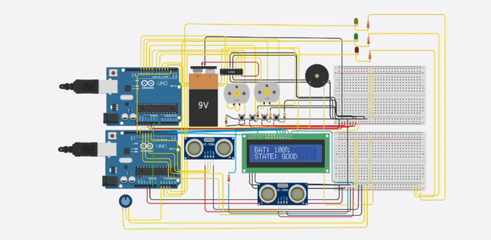

# PatrolBot: An Autonomous Security Patrol Robot

A compact differential-drive mobile robot for indoor security patrol, built up in four layers: manual control, DC motor modelling with PID speed regulation, ultrasonic obstacle safety, and battery-state supervision.

Developed as part of the **Industrial Robotics** course.



## What it does

| Level | Feature | How it works |
|---|---|---|
| 1 | Manual motion and telemetry | Four push buttons drive forward, backward, left and right. Serial output reports the movement state and commanded wheel speed. |
| 2 | Motor model and PID control | DC motor modelled from armature resistance, inductance, back-EMF, torque, rotor inertia and viscous friction. The resulting transfer function is the plant for PID speed control, designed and tuned in MATLAB/Simulink. A state-space model is included for future coupled-wheel control. |
| 3 | Obstacle safety | Two ultrasonic sensors, a buzzer and a 16×2 LCD. Above 40 cm: full speed. 20–40 cm: proportional slowdown. Below 20 cm: full stop with a threat message. |
| 4 | Battery supervision | A non-blocking finite-state machine monitors battery state (a potentiometer stands in for the battery in simulation). LEDs, LCD messages and serial logs show the state. In the critical state, motion is locked and a continuous warning sounds. |

### Motor transfer function (voltage to speed)

```
                 Kt
G(s) = ---------------------------------------
        L·J·s² + (L·B + R·J)·s + (R·B + Kt·Kb)
```

## Hardware

- Arduino Uno
- DC motors in a differential-drive arrangement
- 2 × HC-SR04 ultrasonic sensors
- 16×2 LCD
- Buzzer, status LEDs, push buttons
- Potentiometer (simulated battery level)

## Repository contents

```
docs/PatrolBot_Project_Report.pdf   Full project report (modelling, control design, sensing, FSM, results)
media/PatrolBot_Simulation.mp4      Simulation run showing the battery and obstacle states
media/circuit_simulation.png        Simulated circuit
```

## Notes

Motor parameters used for the model and PID tuning are illustrative assumed values, not measurements from a specific motor. The report identifies them as such.

## Author

**Vishnupriya Subramanian**
